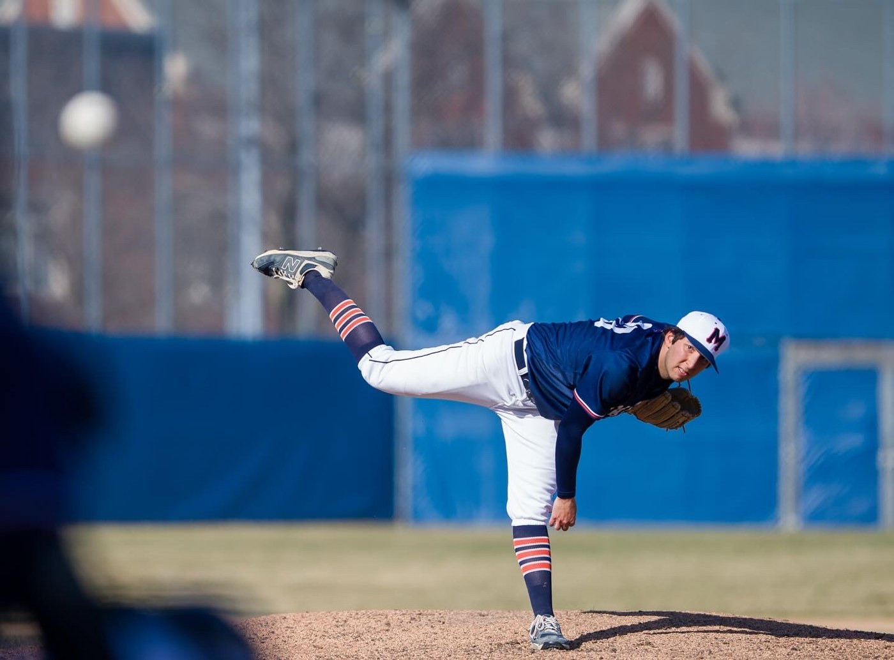

::: {#intro-heading}

::: {.lead-intro}
I'm a Master of Science in Business Analytics student at UT Austin's McCombs School of Business, graduating in May 2027. I use statistics, modeling, and data tools to help organizations make better decisions.
:::

## About Me

My path into analytics started with a statistics degree at Macalester College, where I also played on the baseball team. That combination shaped how I think: I'm most interested in problems where good data and good models change real decisions, whether that's on a field or in a business.

{.about-photo fig-alt="Jacob Posner pitching for Macalester College"}

After Macalester, I worked as a catastrophe modeling analyst at Aon, running catastrophe models and turning their outputs into summaries that informed multi-million-dollar reinsurance decisions. I'm now at UT Austin building my toolkit in machine learning, optimization, and unstructured data, while working as a business analytics intern at Basal Strength, a strength-training startup, where I'm building an R analytics pipeline and Shiny dashboard.

## What I'm Interested In

I'm especially drawn to sports analytics and sports science, and more broadly to analytics and modeling roles where I can turn messy data into clear recommendations.

Outside of work and school, you'll probably find me watching baseball.

[See my resume →](resume.qmd){.btn .btn-primary}

:::
