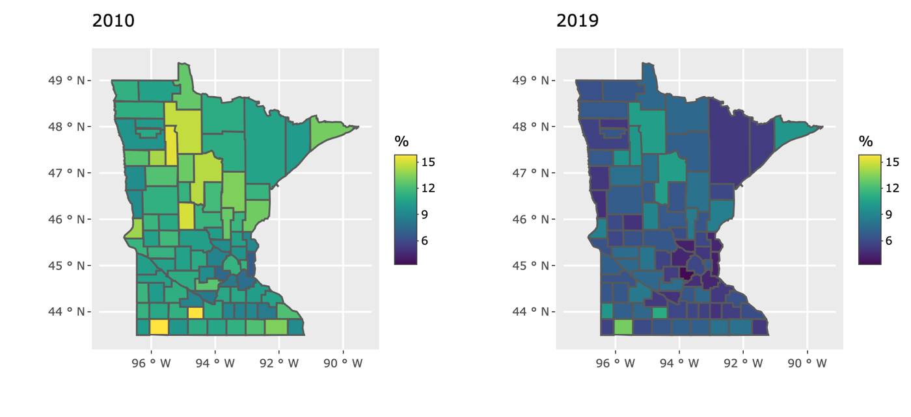
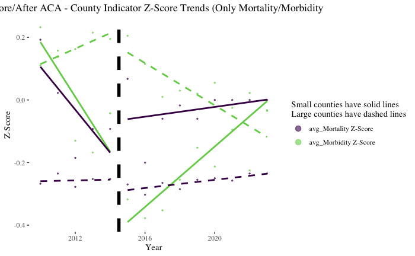

[View the code on GitHub](https://github.com/Jposner33/Projects_DS_Healthcare){.btn .btn-primary target="_blank"}

## Overview

The Affordable Care Act expanded health insurance coverage across the country, but its effects were not the same everywhere. This project, completed for the Projects in Data Science capstone at Macalester College, examines how healthcare access and health outcomes changed across Minnesota's counties before and after the ACA.

## Approach

- Combined Census Small Area Health Insurance Estimates (SAHIE) with County Health Rankings data from 2010 onward
- Compared before-and-after trends in insurance coverage and county health indicators, including clinical care, health behaviors, and the physical environment
- Contrasted the state's largest counties with its smallest to see whether county size shaped the ACA's impact
- Built an interactive R Shiny app with county-level maps that lets users explore coverage trends by year, age, sex, and income

## Key Findings

- Uninsured rates fell sharply across Minnesota after the ACA took effect.
- Large counties saw significantly greater improvement in health indicators than small counties.
- The uninsured rate ticked back up slightly between 2015 and 2019, a period of rising premiums and reduced federal support for the law.

