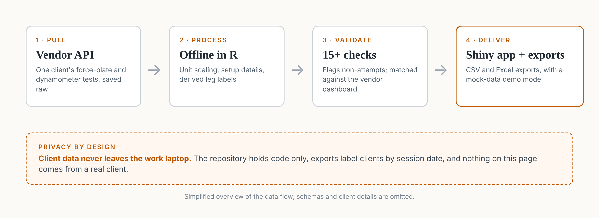

::: {.callout-note appearance="simple"}
This is internal work for Basal Strength, so the code and data are private. Everything on this page is de-identified: no client names, IDs, or results are shown.
:::

## Overview

Basal Strength is an Austin startup that runs in-depth strength assessments, using force plates and handheld dynamometers to measure things like jump performance, isometric strength, balance, and left/right asymmetry.

The vendor's web dashboard shows results one client at a time, but getting that data into a usable form for reports and analysis meant a lot of manual work. As a business analytics intern, I built the system that does it automatically: an R pipeline that pulls a client's testing data from the testing vendor's API, cleans and checks it, and exports it, plus a Shiny app that wraps the whole process.

## How It Works

{fig-alt="Four-step diagram: pull test data from the testing vendor's API, process it offline in R, validate it with automated checks, and deliver it through a Shiny app and exports"}

**1. Pull and save.** For one client and date range, the pipeline requests every test and trial from the API, reading every page of results, and saves each raw response unchanged in a time-stamped folder. A manifest records exactly what was pulled, including a fingerprint of the vendor's 530 metric definitions so any change to them gets flagged.

**2. Process offline.** A separate step cleans and joins the data without calling the API again. It converts raw base-unit values into the units the vendor's dashboard displays, attaches test setup details such as box height and bar load, and works out which leg was tested when the API doesn't say.

**3. Validate.** Every run goes through more than 15 automated data checks, covering missing values, duplicates, rep counts, leg labels, and units. It also flags trials that look like non-attempts, such as a rep under 60% of the athlete's best.

**4. Deliver.** Results are exported as CSV and a readable Excel workbook with a summary tab and one tab per test.

## The Shiny App

The app puts the pipeline behind a simple interface, with tabs for:

- **Overview** of the pull
- **Checks**, showing the result of every data check
- **Summary** of each test, with and without flagged trials
- **Repeatability** across trials
- **Hub comparison** against the vendor's own dashboard values
- **Files** to download the exports

It also has a demo mode that runs on mock data, so it can be shown without exposing any client information.

## Validating Against the Source

I didn't want to trust the pipeline just because it ran. Across five client pulls, I checked every exported test against the values in the vendor's own dashboard, and they matched. The process also turned up several things the dashboard doesn't make obvious:

- **Unit labels can be misleading.** The API returns base units, and the displayed value depends on a per-metric scale factor. Using those factors removed every hand conversion.
- **Small accidental contacts count as reps.** On the dynamometer, a light touch is recorded as a rep and pulled into averages unless it's flagged.
- **Body weight isn't always body weight.** Some tests record only part of the athlete's weight, which distorts any metric normalized by body mass. Using the same session's jump-test weight fixes it.
- **Averages can hide big swings.** One jump's landing-force asymmetry averaged near zero even though individual trials swung more than 30% to each side.

## Privacy by Design

Client data never leaves the work laptop. The data folder is excluded from version control, so the repository holds code only, and exports label clients by session date rather than by name.

## Impact

- **Days saved per client.** Report prep went from manually pulling and cleaning each client's data to a repeatable, scripted process.
- **Data people can trust.** Every number is checked against the source before anyone uses it.
- **A foundation for analysis.** Clean, consistent testing histories set up next steps like trial-to-trial reliability and correlations between metrics.
