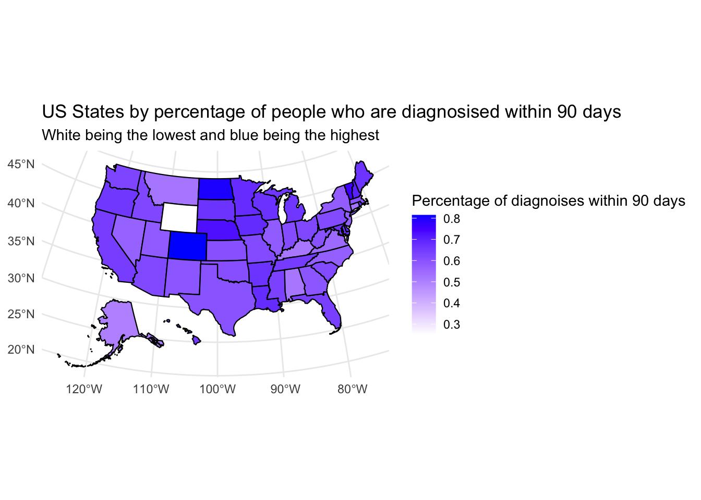
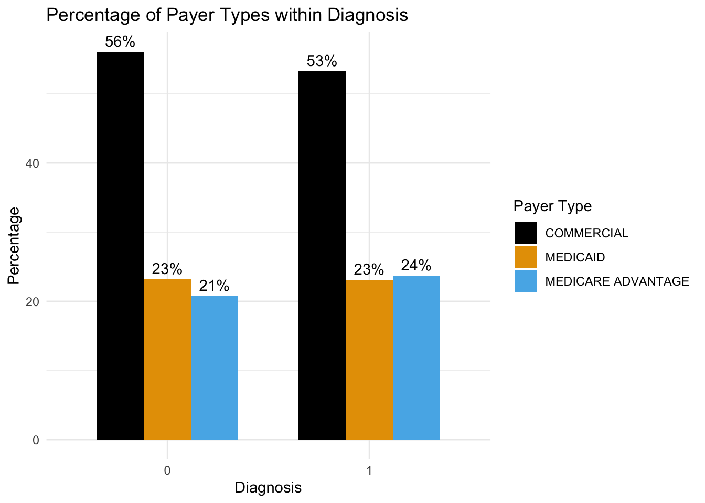

[View the code on GitHub](https://github.com/Jposner33/STAT454-Project){.btn .btn-primary target="_blank"}

## Overview

Access to timely care is not evenly distributed in the United States. This project, completed for Bayesian Statistics at Macalester College, asks which factors affect whether a breast cancer patient is diagnosed within 90 days of their first hospital visit, among patients diagnosed between 2015 and 2018.

## Approach

- Combined patient-level breast cancer data with zip-code demographics and state-level hospital data
- Explored differences in timely diagnosis by state, race, insurance type, income, and age
- Fit Bayesian logistic regression models, including a ridge-style regularized model, and checked convergence and fit with trace plots, autocorrelation, and posterior predictive checks

## Key Findings

- Where a patient lived was strongly associated with timely diagnosis. Holding personal and zip-code demographics constant, a patient in Minnesota had roughly nine times the odds of a diagnosis within 90 days as a similar patient in Alabama.
- Insurance type also mattered, with commercially insured patients making up the largest share of timely diagnoses.
- Limitations include having only a yes/no outcome rather than days to diagnosis, and no hospital-level data.

