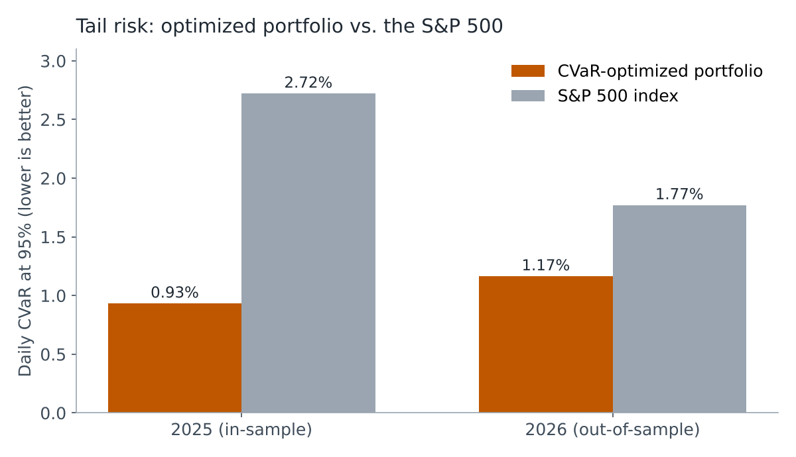
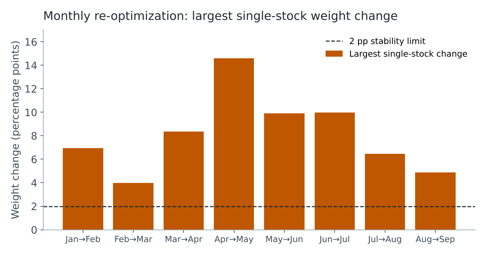

## Overview

Most models predict what will happen. Optimization models decide what to do. This project, completed for Optimization in the UT Austin MSBA program, uses linear programming to make an allocation decision under uncertainty: how to spread money across 496 stocks so that losses on the worst days are as small as possible, while still meeting a minimum expected return.

The risk measure is Conditional Value-at-Risk (CVaR), the average loss on the worst days rather than just a single cutoff. That makes it more sensitive to extreme outcomes than simpler risk measures.

## Approach

- **Data:** collected daily prices for every S&P 500 company, cleaned out tickers with missing history, and kept 496 stocks. The model was built on 2025 data and tested on 2026 data it had never seen.
- **Model:** formulated CVaR minimization as a linear program in Gurobi, with variables for each stock's weight, the risk threshold, and each day's loss beyond that threshold. Constraints require the weights to sum to one and the portfolio to meet a minimum daily return.
- **Scenarios tested:**
  - Different confidence levels (worst 10%, 5%, and 1% of days)
  - A minimax version that minimizes the *worst month's* risk instead of the yearly average
  - Monthly re-optimization on a rolling 12-month window
  - A stability check on how much the portfolio changes from month to month

```python
# Core CVaR linear program (Rockafellar–Uryasev formulation)
model = gp.Model("CVaR")
x = model.addMVar(n, lb=0)                    # portfolio weights
alpha = model.addVar(lb=-gp.GRB.INFINITY)     # value-at-risk threshold
u = model.addMVar(q, lb=0)                    # loss beyond threshold, per day

model.setObjective(alpha + (1 / ((1 - beta) * q)) * u.sum(), gp.GRB.MINIMIZE)
model.addConstrs(u[k] >= -Y[k, :] @ x - alpha for k in range(q))
model.addConstr(x.sum() == 1)                 # fully invested
model.addConstr(y_bar @ x >= R)               # minimum expected return
model.optimize()
```

## Key Findings

- **The optimized portfolio carried far less tail risk than the market.** Its CVaR was about one-third of the S&P 500's in 2025 and about two-thirds in 2026, using a diversified set of 31 stocks.
- **Performance slipped out-of-sample.** Risk rose about 25% from 2025 to 2026, a reminder that market patterns aren't stable and that models should be re-estimated as new data arrives.
- **Re-optimizing every month didn't reliably help.** It lowered risk in some months and raised it in others, averaging only slightly better than the static portfolio.
- **The monthly portfolios were unstable.** Every month-to-month change broke a 2-percentage-point stability limit, often with 20 or more stocks shifting at once, which would be hard to manage in practice.





## Recommendation

Use the static model at the 95% confidence level. It captures meaningful tail risk without relying on the handful of extreme days that made the 99% version unstable, and it avoids the churn of monthly re-optimization. If adapting to new data is a priority, the better next step is adding constraints that cap how much each weight can change month to month, rather than rebuilding the portfolio from scratch.
