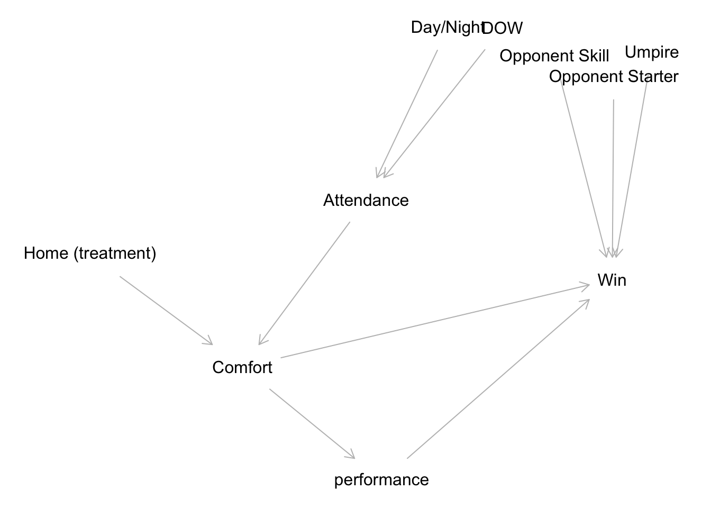
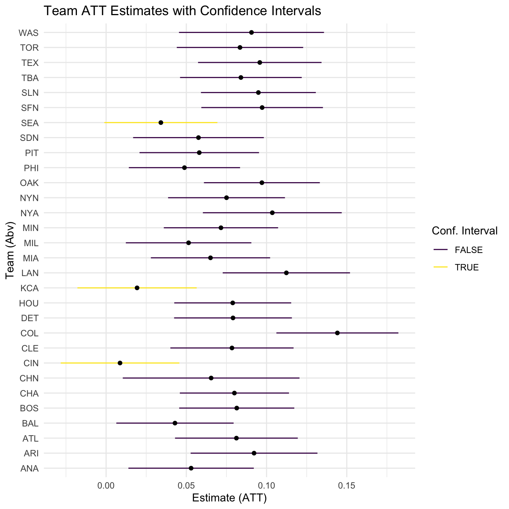
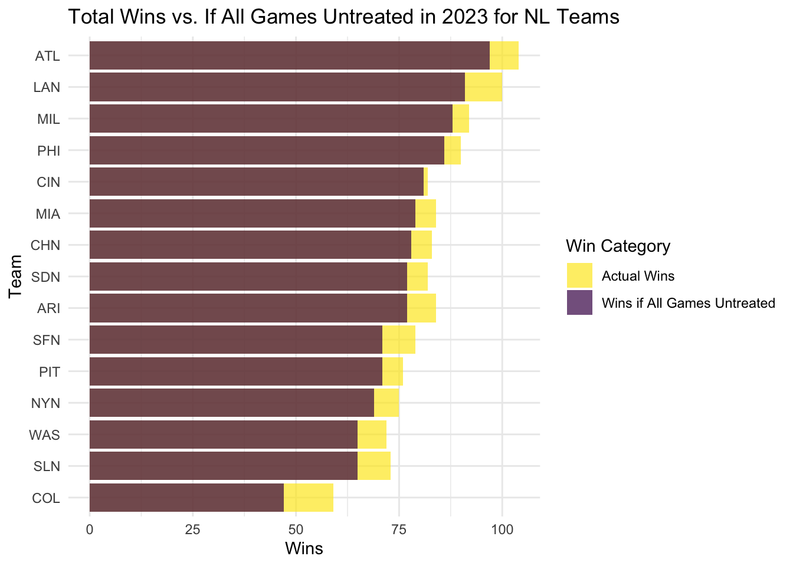

[View the code on GitHub](https://github.com/Jposner33/Causal_Inference_Final_Macalester){.btn .btn-primary target="_blank"}

## Overview

Home field advantage is one of the most debated ideas in baseball. Fans, crowds, batting last, and familiarity with a park's quirks are all thought to help the home team, but how much do they really matter, and does the effect differ from team to team?

This project, completed for the Causal Inference capstone at Macalester College, estimates the causal effect of playing at home on winning for every MLB team, using game data from Retrosheet and Baseball Reference.

## Approach

- Built a causal graph (DAG) to map how home field could affect winning through factors like attendance, comfort, and performance, and to identify confounders such as opponent strength, starting pitcher, day or night games, and day of the week
- Used partial exact matching to compare home games against similar away games for each team
- Estimated the average treatment effect on the treated (ATT) and on the controls (ATC) for all 30 teams
- Ran E-value sensitivity analyses to test how strong an unmeasured confounder would need to be to explain away the results

{width=70%}

## Key Findings

- About half of the league showed a statistically significant boost in win rate at home.
- Teams with distinctive ballparks, such as the Colorado Rockies, Toronto Blue Jays, and New York Yankees, showed some of the largest effects, consistent with factors like elevation and park design.
- Some teams, including the Cincinnati Reds and Chicago Cubs, showed no significant home field advantage.

